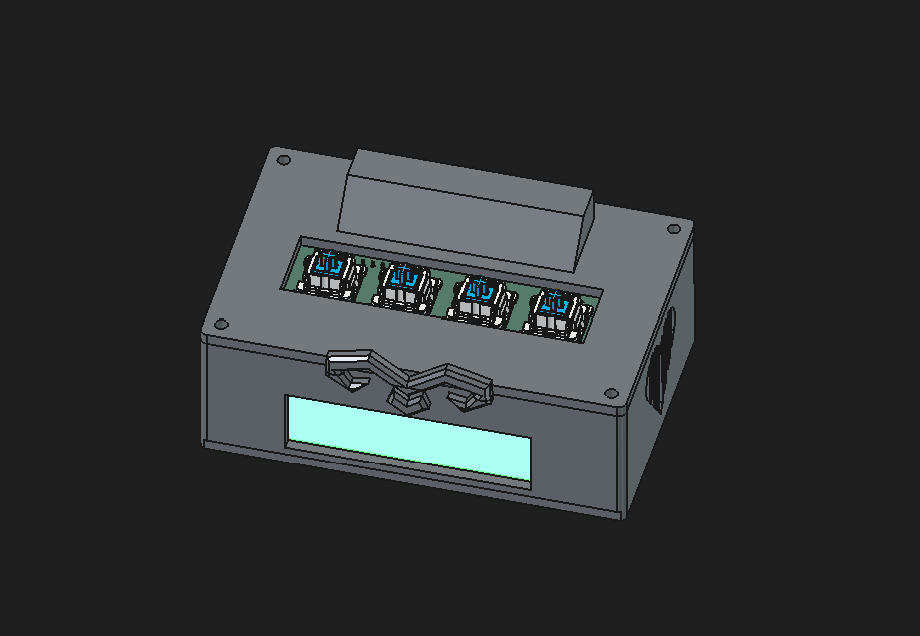
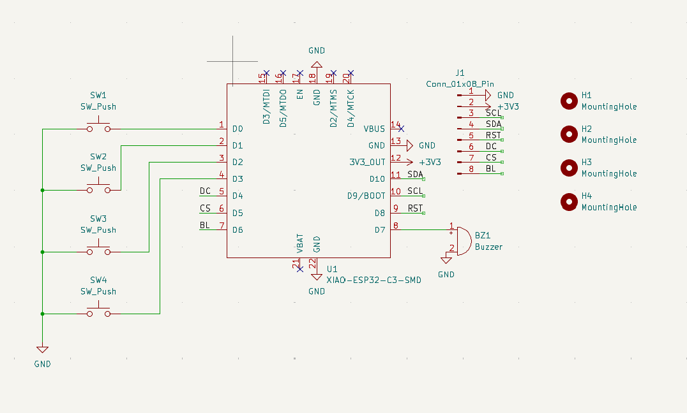
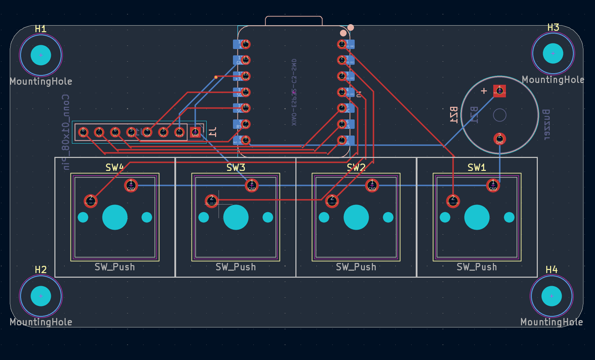

# Solar — Custom Mechanical Alarm Clock

**Solar** is an open-source, customizable mechanical keyboard alarm clock driven by an ESP32-C3 microcontroller. Built as part of the Blare mission

Made by Cherish
---

## Media & Visuals

### Overall Clock

### Schematic

### PCB Layout

### Parts

---

## Features & Design

* **Processor:** Powered by the compact Seeed Studio XIAO ESP32-C3 with Wi-Fi and Bluetooth capabilities.
* **Interface:** Integrated 2.25-inch TFT LCD screen for time display, menu navigation, and alarm status indicators.
* **Inputs:** 12 MX-style mechanical switches arranged in a keypad layout and topped with white blank DSA keycaps for smooth tactile feedback.
* **Audio:** Onboard 3.3V active/passive piezo buzzer for alarm tones and button press confirmation.
* **Enclosure:** 3D printable two-part enclosure designed in FreeCAD featuring custom front decorative accents, precise screen cutouts, top keyplate mounting, and M3 heat-set insert points.

---

## 💻 Software & Firmware Setup

### Prerequisites
* [Arduino IDE](https://www.arduino.cc/en/software)
* Installed ESP32 Board Manager Support (`esp32` by Espressif)

### Installed Libraries
Required libraries available in the Arduino Library Manager:
* **Adafruit ST7789 / GC9A01 Library** 

### Flashing Firmware
1. Open the project sketch folder in your editor.
2. Select **Seeed Studio XIAO ESP32C3** as your target board.
3. Plug in your XIAO via USB-C.
4. Verify and Upload the project firmware.

## Bill of Materials (BOM)

| Item # | Part Name / Description | Qty | Designation / Notes | Reference Link |
| :---: | :--- | :---: | :--- | :--- |
| 1 | Seeed XIAO ESP32-C3 Microcontroller | 1 | Main MCU / WiFi + BLE | [Seeed Studio Store](https://www.seeedstudio.com/Seeed-Studio-XIAO-ESP32C3-3PCS-p-5920.html) |
| 2 | MX-Style Keyboard Switches | 12 | Keypad Switches | [Mechanical Keyboards Store](https://mechanicalkeyboards.com/) |
| 3 | White Blank DSA Keycaps | 12 | 1u Blank Keycaps | [Flashquark Keycaps](https://flashquark.com/product/dsa-blank-pbt-keycaps-white/) |
| 4 | 1N4148 Diodes | 12 | Switch Matrix Diodes (DO-35) | [DigiKey Product Page](https://www.digikey.sg/en/products/detail/good-ark-semiconductor/1N4148/18649117) |
| 5 | 2.25in TFT LCD Screen | 1 | Display Module | [Adafruit Displays](https://www.adafruit.com/category/63) |
| 6 | 3.3V Piezo Buzzer | 1 | Alarm / Audio Feedback | [Electrokit Store](https://www.electrokit.com/en/piezohogtalare-aktiv) |
| 7 | 2.54mm 8-Pin Male Header | 1 | TFT Display Header | [DigiKey Pin Headers](https://www.digikey.sg/) |
| 8 | 20cm Female-Female Jumper Wires | 8 | Off-PCB Screen Wiring | [Adafruit Wires](https://www.adafruit.com/product/1954) |
| 9 | M3x5x4mm Heatset Inserts | 8 | Enclosure Brass Inserts | [McMaster-Carr Inserts](https://www.mcmaster.com/heat-set-inserts/) |
| 10 | M3x8mm Screws | 4 | Enclosure Assembly Screws | [McMaster-Carr Screws](https://www.mcmaster.com/screws/) |
| 11 | M3x16mm Screws | 4 | Extended Fasteners | [McMaster-Carr Screws](https://www.mcmaster.com/screws/) |